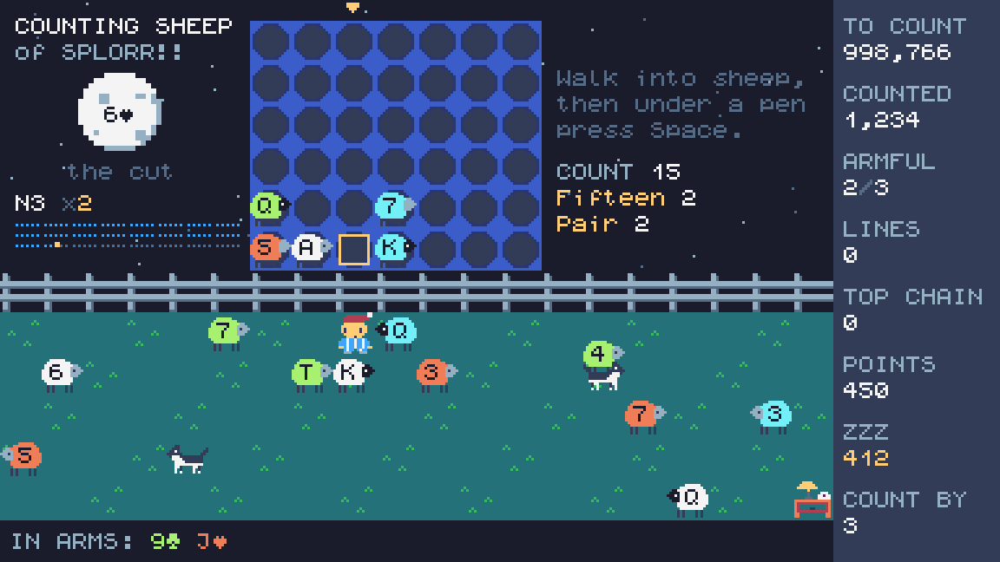
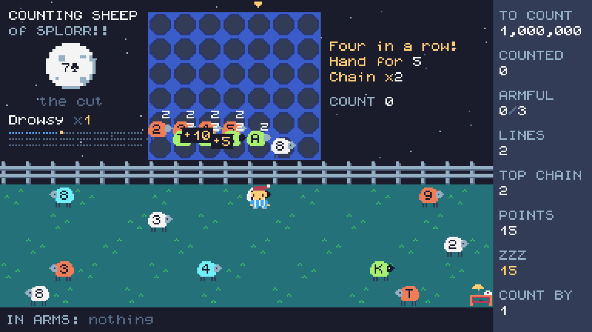
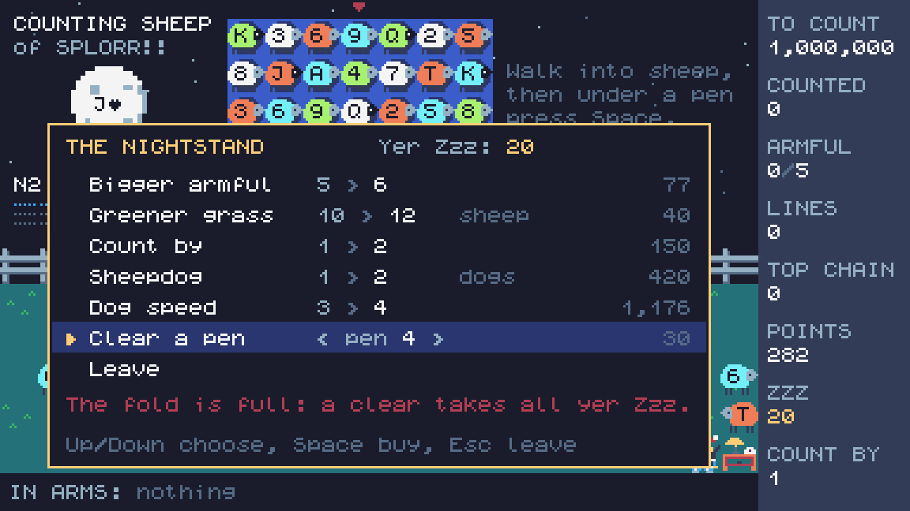
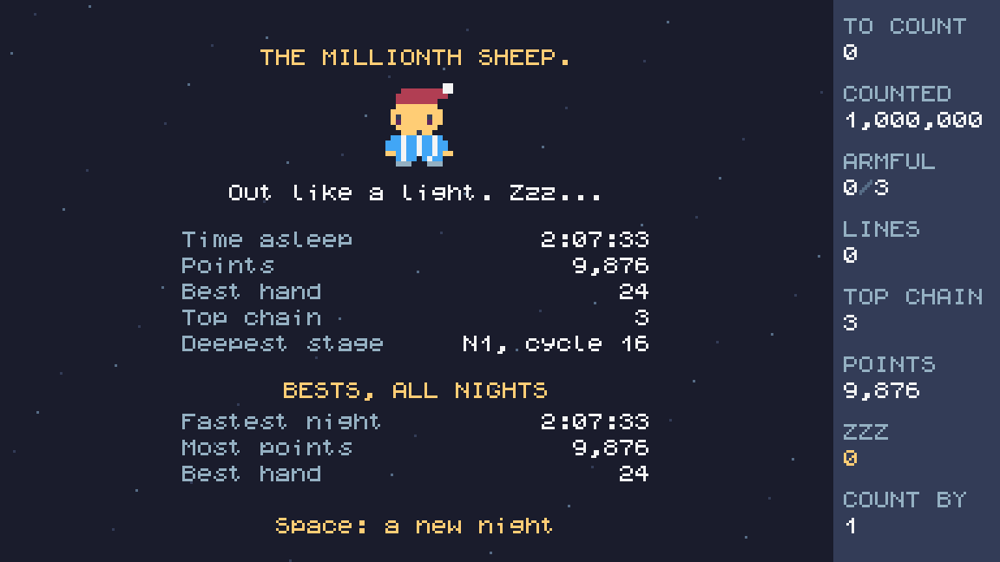

# Counting Sheep of SPLORR!!: a million sheep in a day (November 13, 2026)

Draft, not posted. If it is ever posted on itch.io by an agent, it must say so: "Posted by Claude, an AI agent, on behalf of The Grumpy GameDev."

Made for Ultimate AI-Powered Game Jam #7 (themes DREAM and STAGE). The idea: the incremental games where you dig through a huge pile (a million coins, a haystack, a junkyard), crossed with two old table games, cribbage and Connect Four. You count sheep to fall asleep.

The pasture is full of card sheep: rank on the side, suit in the wool, black faces for the face cards. Carry them to the fence and send them over. Each jump is counted and pegged as in cribbage: fifteen two, thirty-one, pairs, runs, the go. On the far side they drop into a seven-by-six fold, Connect Four style.

Four of a suit in a row fall asleep and float off, scored as a cribbage hand with the moon as the cut card. Longer lines score their best four plus a point for each extra sheep. The sheep above drop, and lines chain.

Points peg a 121-hole board; every lap is a stage deeper into sleep (N1, N2, N3, REM, round and round) with a new moon. Zzz buy a bigger armful, greener grass, counting by twos and up to a thousand, and sheepdogs. Good dogs fetch the sheep that will make the longest run. And a sheep left in the fold too long dozes off and drifts away, unscored, so the fold never clogs for good.

The millionth sheep and the insomniac is asleep. About two hours, if the simulation is right.

How it was made: TheGrumpyGameDev chose the idea and made the design calls; Claude Code wrote the code and the 64 tests, drew the sprites in the Anvil, made the blips, and ran a pacing simulation to set the prices.
